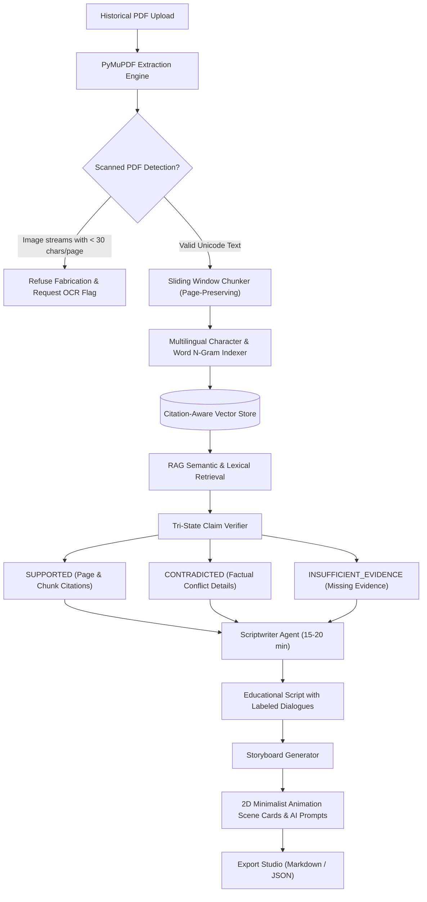

# ChronicleAI — Technical Architecture Documentation

## 1. Executive Summary

**ChronicleAI** is an open-source, citation-grounded AI historical research and video production platform. It ingests historical primary and secondary documents (PDFs), extracts multilingual Vietnamese text while preserving strict page-to-chunk provenance, indexes passages into a citation-aware vector store, verifies historical claims into three deterministic categories (`SUPPORTED`, `CONTRADICTED`, `INSUFFICIENT_EVIDENCE`), drafts 15–20 minute educational video scripts with clearly labeled fictional dialogues, and converts scripts into 2D minimalist animation storyboards with production-ready AI image prompts.

---

## 2. End-to-End Pipeline Workflow



---

## 3. Core Architectural Decisions

### 3.1 Document Ingestion & Page Traceability (Milestone 1)
- **Engine**: PyMuPDF (`fitz` / `pymupdf 2.1`).
- **Rationale**: Unlike standard OCR or naive text extraction libraries, PyMuPDF accurately handles complex Vietnamese diacritics, retains 1-indexed page boundaries, extracts PDF metadata, and inspects raw image streams.
- **Scanned Document Guard**: If a document has pages with image objects but negligible text density (`< 30` characters per page), ChronicleAI explicitly sets `ocr_required=True` and status `scanned_ocr_required`. It strictly refuses to hallucinate text for unreadable scans.
- **Traceability Contract**: Every chunk carries:
  ```json
  {
    "chunk_id": "doc_id_p01_c001",
    "page": 1,
    "source": "le_thanh_tong_dai_viet.pdf",
    "document_id": "doc_id",
    "text": "...",
    "word_count": 85
  }
  ```

### 3.2 Multilingual Embeddings & Vector Store (Milestone 2)
- **Engine**: Hybrid character n-gram (3-5) + subword TF-IDF vectorization with cosine similarity (`scikit-learn` + `numpy`).
- **Rationale**: Vietnamese is an isolating language with tonal diacritics and compound words. Character n-gram subword analysis natively handles historical terms (e.g. *Lê Thánh Tông*, *Quốc Triều Hình Luật*, *Hồng Đức*, *Tao Đàn*, *Thân Nhân Trung*) without requiring 1GB PyTorch model downloads or GPU dependencies.
- **Modular Provider**: Easily swappable with OpenAI embeddings or Google Gemini embeddings via configuration.

### 3.3 Tri-State Fact Checking & Contradiction Detection (Milestone 2)
Every claim undergoes multi-pass verification against retrieved source chunks:
1. **Contradiction Detection**:
   - Temporal conflict: Claims asserting an event occurred in year $X$ when sources record year $Y$ (e.g., accession in 1520 vs. historical record 1460).
   - Polarity conflict: Assertions of defeat (*thất bại*, *đánh bại*) when source records victory (*đại thắng*), or abolition when source records establishment.
2. **Missing Evidence Detection (`INSUFFICIENT_EVIDENCE`)**:
   - Content word token extraction excluding common functional words.
   - If key entities or actions (e.g., *châu Âu*, *Elizabeth*, *tên lửa*, *máy bay*) are absent from retrieved evidence, the claim is labeled `INSUFFICIENT_EVIDENCE`.
3. **Corroboration (`SUPPORTED`)**:
   - Corroborated statements are assigned a confidence score and citations referencing exact filename, page number, and chunk ID.

### 3.4 Scriptwriting Agent (Milestone 3)
- **Target Video Length**: 15–20 minutes (~900–1200 seconds total narrative pacing).
- **Structure**:
  1. Opening Hook (dramatic entry)
  2. Historical Background (geopolitical context)
  3. Chronological Narrative (accession, 13 Đạo thừa tuyên, Lục Bộ)
  4. Key Achievements (Quốc Triều Hình Luật, Văn Miếu Doctor Stelae, Tao Đàn)
  5. Border Defense & Conflict (1471 Chiêm Thành campaign & territorial oath)
  6. Engaging Conclusion & Historical Legacy
- **Dialogue Labeling**:
  - `HISTORICAL_QUOTE`: Authentic recorded speech (with page citation).
  - `FICTIONAL_DRAMATIZATION`: Creative dialogue, explicitly demarcated to avoid misleading viewers.
- **Unverified Fact Warning**: Any scene lacking source evidence is automatically tagged `needs_review=True`.

### 3.5 Storyboard Generator (Milestone 4)
- **Art Direction**: Minimalist 2D Vietnamese historical animation with stick-figure-inspired characters.
- **Visual Features**: Clean vector lines, authentic 15th-century costumes (*áo giao lĩnh*, *khăn đóng*), subtle watercolor wash backgrounds.
- **Camera Staging**: Low angles, pans, zooms, wide shots matching documentary pacing.
- **AI Prompts**: Formatted for Midjourney, DALL-E 3, and Gemini Imagen.

---

## 4. API Service Layout

| Router | Method | Endpoint | Description |
|---|---|---|---|
| Documents | `POST` | `/api/documents/upload` | Ingest PDF, extract text, detect scans, index chunks |
| Documents | `GET` | `/api/documents` | List uploaded documents and metadata |
| Documents | `GET` | `/api/documents/{id}/chunks` | Inspect chunked text and page numbers |
| RAG | `POST` | `/api/rag/search` | Search indexed historical evidence chunks |
| RAG | `POST` | `/api/rag/answer` | Generate grounded answer with page citations |
| Verify | `POST` | `/api/verify/claims` | Verify batch claims (SUPPORTED, CONTRADICTED, INSUFFICIENT) |
| Scripts | `POST` | `/api/scripts/generate` | Generate full 15-20 min video script |
| Scripts | `POST` | `/api/scripts/export/markdown` | Export script as formatted Markdown |
| Storyboards | `POST` | `/api/storyboards/generate` | Convert script to 2D animation storyboard |
| Storyboards | `POST` | `/api/storyboards/export/markdown` | Export storyboard as Markdown |
